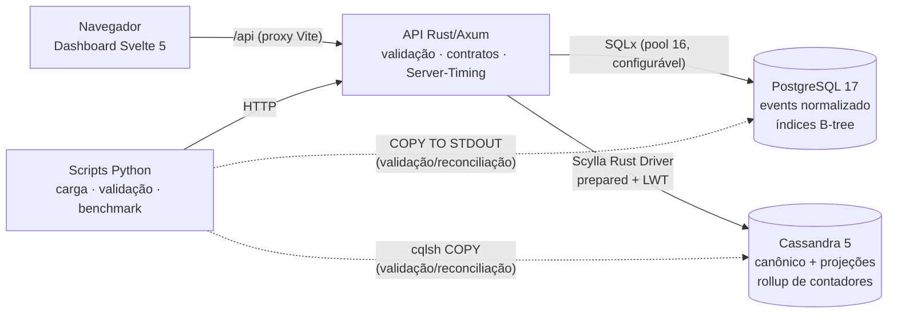

# Arquitetura

## Decisão

O sistema é um monólito modular em Rust (Axum/Tokio), com frontend Svelte 5 independente e scripts Python de engenharia de dados. Os dois bancos locais são **fontes alternativas para o mesmo domínio**: cada requisição escolhe uma fonte pelo caminho (`/api/{postgresql|cassandra}/…`). Não há escrita dupla escondida nem transação entre os bancos.

| Módulo | Responsabilidade |
| --- | --- |
| `backend/src/api` | Health, runtime, CRUD, Q1/Q2/Q3, painel (`/stats/overview`), repair e resumo de benchmarks. Limites de corpo e prazo, erros sanitizados, CORS restrito e `Server-Timing` |
| `backend/src/config.rs` | Variáveis validadas, sem `Debug` (contém credenciais). Inclui `CASSANDRA_READ_CONCURRENCY` (1..128), `POSTGRES_POOL_SIZE` (1..64, padrão 16), `POSTGRES_SYNCHRONOUS_COMMIT` (on/off) e `BENCHMARK_SUMMARY` |
| `backend/src/domain` | Evento canônico, validação, identidade imutável e atualização com revisão |
| `backend/src/analytics` | Contratos de Q1–Q3 (janela, cursor keyset) e do painel (horas inteiras, filtros, montagem idêntica para as duas fontes) |
| `backend/src/storage` | Adaptadores PostgreSQL (transações, SQL com fragmentos fixos) e Cassandra (LWT, logged batch, leituras canônicas concorrentes, contadores) |
| `frontend/` | Dashboard SOC: indicadores, série horária, severidade, categorias, comparação ao vivo, investigação Q1–Q3 e resultados de benchmark |
| `scripts/` | Ambiente, esquemas, execução da API em contêiner, geração/carga/validação e reconciliação do rollup |
| `benchmarks/` | Executor experimental e resultados brutos, separados das consultas de negócio |

A ingest?o usa o CREATE da API, e o executor fica em `benchmarks/`. N?o h? m?dulos fict?cios.

## Fluxos

- **Saúde:** as sondas são efêmeras e concorrentes. O PostgreSQL responde a `SELECT 1` e o Cassandra a `system.local`. O resultado é degradado se qualquer fonte falhar, e a duração **não** é benchmark.
- **Eventos:** cliente → validação de domínio → repositório da fonte → banco. O PostgreSQL grava evento, reserva de UUID e dispositivo em uma transação. O Cassandra segue `pending → projeções (logged batch) → active` com LWT e incrementa o rollup.
- **Consultas Q1–Q3:** o PostgreSQL lê o índice composto em uma consulta. O Cassandra lê até 7 partições diárias e busca o conteúdo canônico com concorrência limitada.
- **Painel:** o PostgreSQL agrega na leitura (*index-only scan*). O Cassandra lê até 7 partições do rollup em paralelo.
- **Massa:** gerador determinístico em streaming → manifesto → carga via CREATE com checkpoint → validação integral ([bulk-load.md](bulk-load.md)).
- **Benchmarks:** `run_benchmarks.py` → API release → `raw.csv` / `environment.json` / `run.json` → `summary.json` → dashboard ([benchmark-methodology.md](benchmark-methodology.md)).

## Consultas de negócio e experimentos

As consultas de negócio ficam na API. A repetição, o aquecimento, a ordem e a persistência de tempos brutos ficam em `benchmarks/run_benchmarks.py`. A API só expõe instrumentação neutra: `Server-Timing`, que mede o adaptador de armazenamento com relógio monotônico, e `/api/runtime`. Resultados negativos e cenários favoráveis ao relacional são mantidos.

## Um nó Cassandra

Um único nó economiza recursos na máquina de 16 GB e permite avaliar modelagem e consultas. Ele **não** demonstra escalabilidade horizontal, tolerância a falhas nem *quorum* real. O keyspace usa `NetworkTopologyStrategy` com `datacenter1: 1`, `LOCAL_QUORUM` e `LOCAL_SERIAL`. Replicação e distribuição são explicadas na teoria ([entregas/10-11-pesquisa-cassandra.md](entregas/10-11-pesquisa-cassandra.md)), sem extrapolar números de um nó para um cluster.

## Limites locais

- O Compose mantém apenas Cassandra e PostgreSQL, em uma rede bridge dedicada, com volumes persistentes e portas em loopback. Não se usa `internal: true`, porque no Engine 29 isso impediu publicar as portas.
- A API roda nativamente (`cargo run`) ou no contêiner oficial do Rust via `scripts/run_api.py`, na mesma rede, com o repositório montado como somente leitura e publicação em `127.0.0.1:3000`. Isso não acrescenta serviço permanente ao Compose.
- O PostgreSQL tem senha. O Cassandra usa autenticação permissiva, o que é aceitável apenas neste laboratório local.
- Não há Kafka, Redis, Elasticsearch, Kubernetes nem publicação externa.

## Refer?ncia consolidada

### analytics

# Analytics

`mod.rs` define os contratos de consulta compartilhados pelos dois bancos:

- **Q1** (dispositivo), **Q2** (IP) e **Q3** (alertas por severidade exata): janela `[from,to)` de até sete datas UTC, páginas de 1 a 100 eventos e cursor keyset vinculado ao filtro.
- **Painel** (`OverviewQuery`): janela em horas inteiras UTC, até sete datas, filtros opcionais de categoria e severidade. Os dois adaptadores devolvem células `(hora, categoria, severidade, contagem)`, e `build()` monta a mesma resposta: totais, alertas, distribuição e série horária com todas as horas preenchidas. Com o mesmo estado lógico, a resposta é byte a byte idêntica nas duas fontes.

As consultas físicas ficam nos adaptadores de storage e estão documentadas em `docs/query-patterns.md`. A repetição de medições não pertence a este módulo (ver `benchmarks/`).

### domain

# Domínio

`mod.rs` implementa EventData, envelope Event/revision, UpdateEvent e validações independentes de persistência. UUID v4, UTC em milissegundos, data derivada, IP canônico, tipos por categoria, severidade e JSON limitado estão documentados em `docs/data-model.md`.

Campos de roteamento são imutáveis; PUT altera somente outcome/message/metadata com revisão esperada. Manter o mesmo contrato nas duas fontes.

### ingestion

# Ingestão

Não há endpoint de ingestão em lote nem módulo Rust próprio. A carga volumosa (`scripts/loading/load_bulk.py`) e as escritas do benchmark (E6) usam o CREATE existente, `POST /api/{fonte}/events`. Assim ficam preservados a validação, a idempotência por UUID, a transação PostgreSQL e o fluxo `pending/active` do Cassandra, inclusive o incremento do rollup do painel.

A Task 04 mediu esse caminho e mostrou que o custo do CREATE Cassandra vem das 2 LWT e do batch (`docs/benchmark-methodology.md`, E6). Um caminho de bulk sem LWT seria mais rápido, mas abriria mão da garantia contra reutilização de UUID. Por isso não foi criado.

### benchmark

# Benchmark

O executor experimental fica fora do backend, em `benchmarks/run_benchmarks.py`, para não misturar repetição de medições com as consultas de negócio. O backend contribui apenas com instrumentação neutra:

- cabeçalho `Server-Timing: db;dur=<ms>` em READ, Q1–Q3 e painel, com o tempo monotônico do adaptador de armazenamento;
- `GET /api/runtime`, que informa build, `CASSANDRA_READ_CONCURRENCY`, `POSTGRES_SYNCHRONOUS_COMMIT` e `POSTGRES_POOL_SIZE`, para que o executor recuse configurações erradas;
- `GET /api/benchmarks/summary`, que serve somente leitura o `summary.json` medido.

Metodologia e resultados: `docs/benchmark-methodology.md`.
