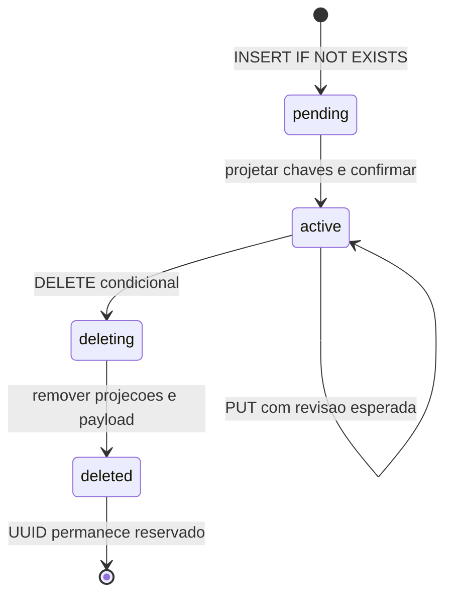

# Consistência, concorrência e recuperação

## Garantias comuns da API

- Cada operação seleciona **um** banco pelo caminho. Não existe transação distribuída entre PostgreSQL e Cassandra nem dual-write automático escondido.
- CREATE usa UUID fornecido pelo cliente. Novo evento retorna 201/revisão 1; repetição idêntica de um CREATE já concluído retorna 200. Mesmo UUID com conteúdo diferente, revisão já alterada ou UUID excluído retorna 409.
- READ de evento ativo retorna 200; inexistente/excluído retorna 404. Não se devolve sucesso fictício para falhas de armazenamento.
- PUT substitui o conjunto mutável completo (`outcome`, `message`, `metadata`) com `expected_revision`. Revisão antiga retorna 409. Repetição imediatamente após sucesso, com a revisão antiga e exatamente os mesmos valores agora armazenados, retorna 200 sem incrementar novamente. Após outras mudanças, consultar a revisão atual.
- DELETE exige `expected_revision`. Revisão incorreta retorna 409; sucesso retorna 204. Repetição de DELETE já concluído retorna 204. UUID nunca visto retorna 404. O UUID excluído permanece reservado; o conteúdo do evento deixa de estar disponível.
- Validação precede I/O. Campos de partição, clustering, categoria e severidade são imutáveis. Isso evita realocar chaves durante UPDATE.
- Consultas são páginas de dados atuais, não snapshots globais ou entre bancos. A equivalência é exigida para o mesmo estado lógico estável e mesmos parâmetros.

## PostgreSQL

CREATE, PUT e DELETE usam transações. A linha correspondente de `event_registry` é bloqueada com `FOR UPDATE` para serializar alterações do mesmo ID. CREATE registra dispositivo, reserva e evento na mesma transação; DELETE remove a linha `events` e marca a reserva como excluída no mesmo commit. As FKs e índices são mantidos pelo SGBD. Leituras usam o comportamento MVCC padrão de cada comando; não se promete snapshot entre requisições.

Em erro antes do commit, o driver abandona a transação e ocorre rollback. Uma perda de conexão durante o commit pode deixar o resultado desconhecido para o cliente: consultar o ID e repetir a mesma intenção, respeitando revisão. `repair` neste banco apenas informa `active`/`deleted`; não há projeções a reconstruir.

## Cassandra

Não há transação relacional abrangendo as tabelas. A linha canônica por ID é a autoridade para conteúdo e visibilidade. Sua reserva, revisão e ciclo de vida usam instruções condicionais (LWT). Operações usam `LOCAL_QUORUM` e as condições usam `LOCAL_SERIAL`; com RF=1 isso corresponde ao único nó, não oferece redundância ou tolerância a falha do servidor.

### CREATE

1. Reservar o UUID em `events_by_id` com payload canônico, revisão 1 e `lifecycle=pending`, usando `IF NOT EXISTS`.
2. Escrever as duas projeções comuns e, para alertas, a terceira em um **logged batch pequeno**, exclusivo daquele evento.
3. Mudar condicionalmente `pending → active` e somente então retornar sucesso.

Batch log auxilia o replay de mutações, mas não torna leituras de várias partições isoladas como uma transação SQL. Por isso registros `pending` não são expostos como ativos: READ por ID retorna 503 `operation_pending`, e consultas ignoram seus índices até a ativação.

### UPDATE

Os índices contêm somente identidade imutável. PUT muda payload e revisão na única linha canônica com `IF revision=? AND lifecycle='active'`. Assim, mensagem/metadados não ficam divergentes entre Q1/Q2/Q3. Duas escritas concorrentes com a mesma revisão e conteúdos diferentes têm apenas uma vencedora; a outra recebe 409. Essa propriedade foi testada com requisições simultâneas.

### DELETE

1. Marcar condicionalmente `active → deleting` usando a revisão esperada. Isso bloqueia novas atualizações e retira a visibilidade lógica.
2. Remover as projeções pelas suas chaves completas em logged batch.
3. Mudar `deleting → deleted` e substituir `payload` por `null`.

A linha restante contém UUID, revisão e estado, não o conteúdo do evento. Requisições antigas não conseguem reutilizar esse UUID. Tombstones internos e retenção de marcadores são custos reais; a Task 03 deve acompanhar seu crescimento. A API não oferece expurgo físico de SSTables, dados em backups ou uma garantia de apagamento de mídia.

### Recuperação por ID

`POST /api/cassandra/events/{id}/repair`:

| Estado durável | Ação | Resposta |
| --- | --- | --- |
| `pending` | Repetir projeções com chaves determinísticas, depois ativar | 200 `{"state":"active"}` |
| `active` | Reafirmar os índices imutáveis a partir do conteúdo canônico | 200 `{"state":"active"}` |
| `deleting` | Repetir exclusão dos índices e apagar payload | 200 `{"state":"deleted"}` |
| `deleted` | Não reativar nem recriar payload | 200 `{"state":"deleted"}` |
| Inexistente | Não criar evento | 404 |

Repetir o CREATE idêntico também conclui uma reserva pendente; repetir DELETE com a revisão correta conclui uma exclusão interrompida. A operação de repair não descobre pendências por varredura. O cliente/carregador deve manter um manifesto dos IDs enviados e reconciliar os de resposta incerta. Na Task 03, `load_bulk.py` faz isso: IDs determinísticos regeneráveis pelo manifesto, checkpoint por chunk confirmado, registro de IDs incertos e reenvio do chunk inteiro na retomada (CREATE idêntico conclui `pending`); `check_bulk.py` confirma ausência de `pending`/`deleting` ([bulk-load.md](bulk-load.md)). Se o cliente perder todos os IDs, não há reconciliador global automático nesta versão.

Uma projeção obsoleta de evento inexistente/excluído não produz um evento fantasma porque a leitura consulta o registro canônico. Projeções ausentes podem omitir um evento até repair: não se promete que um batch pendente já esteja visível. Conteúdo canônico inválido retorna 503 `storage_inconsistent`. Excesso de candidatos obsoletos retorna 503 `scan_limit` após 1000 candidatos por página.

## Limites operacionais

- Uma instância de API é o cenário suportado e validado. Há 128 locks locais por faixa de UUID/fonte para evitar intercalar um workflow do mesmo ID na mesma instância, sem alocação ilimitada de locks. PostgreSQL/LWT continuam sendo os controles duráveis; locks locais não coordenam processos distintos.
- Múltiplas instâncias, escritores CQL/SQL externos, pausas entre projeções e mudanças de relógio não foram certificados. LWT impede sobrescrever revisões/estados incompatíveis, mas não oferece fencing entre todos os batches de vários processos. Antes de múltiplos escritores, desenhar coordenação/reconciliação e testar corridas entre repair, CREATE e DELETE. Índices antigos podem exigir limpeza direcionada, mesmo quando a autoridade canônica impede exposição lógica.
- PostgreSQL usa pool de até cinco conexões, timeout de aquisição configurado, `statement_timeout=15000ms` e `lock_timeout=5000ms`. Cassandra usa sessão reutilizável e cache limitado de 32 instruções preparadas, inicializados sob demanda. Os healthchecks originais permanecem independentes dessas conexões de negócio.
- Cada requisição de CRUD/consulta tem deadline de 30 segundos; expirar o cliente não prova rollback no servidor. HTTP 503 `operation_timeout`/`storage_unavailable` pode representar escrita de resultado incerto. O cliente deve ler/reparar o mesmo ID, nunca gerar outro UUID automaticamente como retry.
- Não há autenticação de usuários na API; é laboratório em loopback. `repair` é ferramenta administrativa local. CORS permite a origem local configurada e métodos GET/POST/PUT/DELETE com Content-Type; isso não é autenticação.

As decisões privilegiam correção e rastreabilidade nesta etapa. Canonical lookups, LWT e reservas de UUID têm custo e não são evidência de superioridade de desempenho Cassandra. O futuro benchmark deve medir o fluxo completo, comparar índices/configurações adequados e registrar qualquer limitação.
