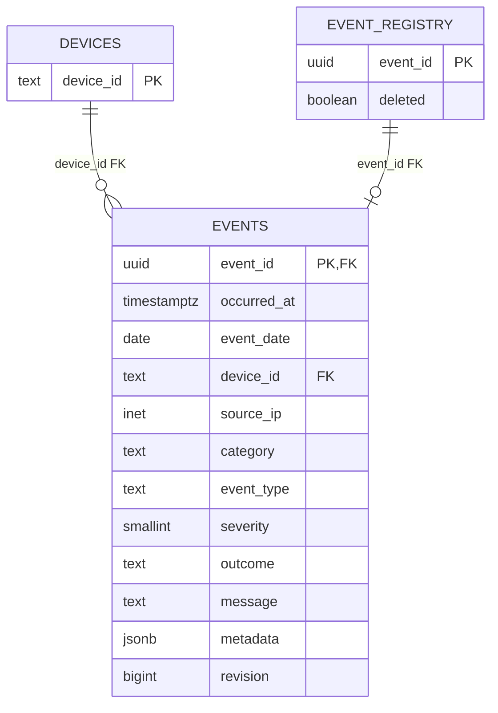
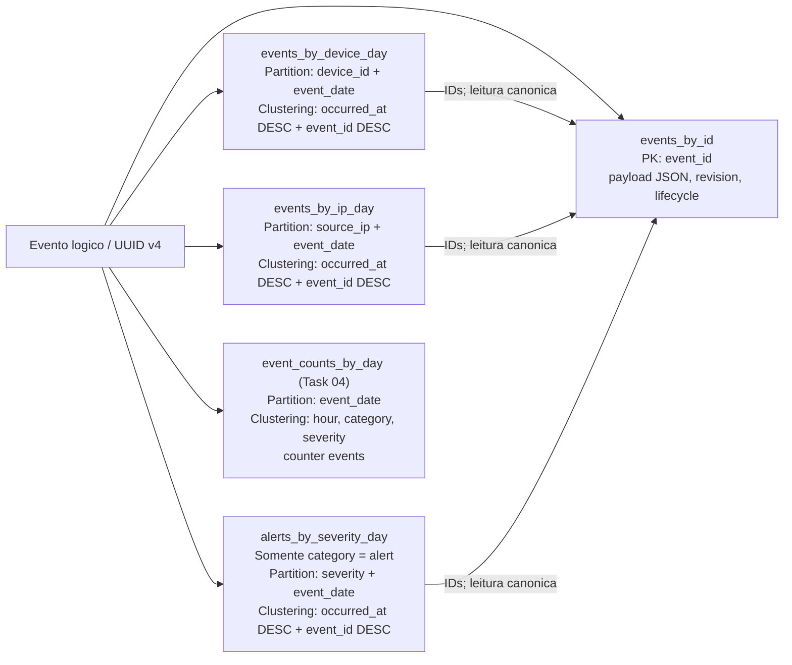

# Modelo de dados CyberGuard v1

## Escopo e inspiração OCSF

O contrato é **próprio do CyberGuard**, inspirado em conceitos do OCSF 1.3.0. Não é uma implementação completa, extensão registrada ou documento validável como OCSF. Os campos/classes obrigatórios e os perfis completos do OCSF não são implementados.

| Categoria CyberGuard | Referência conceitual OCSF 1.3.0 | Tipos locais |
| --- | --- | --- |
| `authentication` | [Authentication](https://schema.ocsf.io/1.3.0/classes/authentication) | `login`, `suspicious_access` |
| `network` | [Network Activity](https://github.com/ocsf/ocsf-schema/blob/1.3.0/events/network/network_activity.json) | `connection`, `traffic_anomaly` |
| `alert` | [Detection Finding](https://schema.ocsf.io/1.3.0/classes/detection_finding) | `potential_threat` |

As categorias acima são agrupamentos locais, não os valores literais de `category_uid` do OCSF. Login falho é `authentication/login` com `outcome=failure`; conexão bloqueada é `network/connection` com `outcome=blocked`. Um alerta registra uma classificação recebida: a API não executa um motor de detecção.

Tempo, dispositivo, endpoint de origem, severidade, mensagem e contexto remetem aos conceitos do [evento base OCSF](https://github.com/ocsf/ocsf-schema/blob/1.3.0/events/base_event.json), mas usam nomes/tipos simplificados. `metadata` é um objeto complementar local, não o objeto Metadata padronizado do OCSF. O timestamp HTTP é RFC3339, não o timestamp numérico do OCSF. `outcome=blocked` é uma decisão local, não uma equivalência direta a `status_id` OCSF.

## Contrato canônico

Um **registro lógico** é um evento identificado por UUID, independentemente de quantas projeções físicas existam. Todos os campos do corpo CREATE são obrigatórios; `metadata` pode ser `{}`. Campos desconhecidos são rejeitados.

| Campo | Tipo HTTP | Regra | Mutável? |
| --- | --- | --- | --- |
| `event_id` | string UUID | UUID v4 RFC 4122, 36 caracteres com hífens; normalizado para minúsculas; não reutilizável após exclusão | Não |
| `occurred_at` | string RFC3339 | UTC (`Z` ou offset zero), precisão máxima de milissegundos, sem segundos intercalares, intervalo `[2000-01-01,2100-01-01)`; saída sempre com três casas e `Z` | Não |
| `event_date` | string `YYYY-MM-DD` | Exatamente a data UTC de `occurred_at`; erro se divergir | Não |
| `device_id` | string | `[a-z0-9][a-z0-9._-]{0,63}`; identificador do dispositivo que originou/relatou o evento | Não |
| `source_ip` | string | Endereço de host IPv4 ou IPv6; CIDR rejeitado; IPv4 mapeado em IPv6 é normalizado para IPv4 | Não |
| `category` | string enum | `authentication`, `network`, `alert` | Não |
| `event_type` | string enum | Combinação permitida na tabela anterior | Não |
| `severity` | inteiro | 1 informativo, 2 baixo, 3 médio, 4 alto, 5 crítico; subconjunto local sem Unknown/Fatal/Other | Não |
| `outcome` | string enum | `success`, `failure`, `blocked`, `unknown` | Sim |
| `message` | string | 1..2048 bytes UTF-8, não composta apenas por espaços; sem NUL | Sim |
| `metadata` | objeto JSON | Até 4096 bytes na serialização compacta canônica, profundidade até 8, chaves até 64 bytes; sem NUL; números apenas inteiros i64 | Sim |

Metadados aceitam objetos, arrays, strings, booleanos, nulos e inteiros. Decimais são rejeitados para evitar diferenças de representação/precisão entre JSONB e JSON textual. O limite HTTP do corpo é 16 KiB, adicional aos limites por campo. Não enviar senhas ou informações pessoais reais nas amostras.

O retorno de CREATE/READ/UPDATE é um envelope `{"data": <evento>, "revision": 1}`. A revisão é gerenciada pelo servidor, inicia em 1 e cresce a cada PUT aceito. É um inteiro positivo i64: ao atingir seu máximo, outro incremento é rejeitado, mas DELETE continua permitido. O cliente não envia `revision` no CREATE. PUT aceita somente `expected_revision`, `outcome`, `message`, `metadata`: campos de identidade/roteamento são imutáveis nesta versão. Corrigir dispositivo, data, categoria ou severidade exige criar outro UUID e excluir o anterior explicitamente; não há migração silenciosa de chaves.

## Exemplo completo

```json
{
  "event_id": "04a51d3e-b1c0-4bd6-a0fb-fac6cf4d9759",
  "occurred_at": "2026-11-06T12:00:00.000Z",
  "event_date": "2026-11-06",
  "device_id": "soc-sensor-01",
  "source_ip": "192.0.2.10",
  "category": "alert",
  "event_type": "potential_threat",
  "severity": 4,
  "outcome": "unknown",
  "message": "Alerta sintetico para validacao academica.",
  "metadata": {"synthetic": true, "source": "local-example"}
}
```

O arquivo `data/samples/events.json` contém a amostra efetivamente carregável: 24 eventos, três dias UTC, dois dispositivos, IPv4/IPv6, todas as categorias, severidades 1..5, login falho, bloqueio e alertas com timestamps empatados. Seu manifesto registra hash, algoritmo de IDs e contagens esperadas. Os UUIDs têm bits v4 e são gerados deterministicamente a partir de SHA-256 para a amostra; não se afirma aleatoriedade criptográfica dessa geração de teste.

## PostgreSQL

Esquema em `database/postgresql/001_events.sql`.



- `events` armazena cada evento ativo uma única vez, em colunas tipadas. `timestamptz` preserva o instante e a API sempre serializa UTC; `inet` representa hosts IPv4/IPv6; JSONB armazena metadados.
- `devices` representa a identidade do dispositivo. A API registra a identidade quando recebe seu primeiro evento. A FK impede referências inexistentes; não se inventam dados de inventário. A exclusão de um evento não exclui automaticamente o dispositivo.
- `event_registry` reserva o UUID e mantém um marcador depois do DELETE, impedindo que retries antigos recriem eventos. A relação permite zero eventos para uma reserva excluída. CREATE/DELETE mantêm reserva e evento na mesma transação.
- PKs e FKs usam `RESTRICT`; não há exclusões em cascata. CHECKs validam UUID v4, data UTC, precisão temporal, endereço de host, severidade, enums e combinação categoria/tipo. Limites de profundidade/tamanho JSON e imutabilidade são garantidos também pela API; escritas diretas fora dela não pertencem ao contrato suportado.
- Índices B-tree:
  - `(device_id, occurred_at DESC, event_id DESC)` para Q1;
  - `(source_ip, occurred_at DESC, event_id DESC)` para Q2;
  - `(severity, occurred_at DESC, event_id DESC) WHERE category='alert'` para Q3, um índice parcial que evita indexar não-alertas.

  Nos três, a igualdade vem antes do intervalo e do desempate. A PK atende READ/UPDATE/DELETE por UUID.
- Painel (Task 04, `002_dashboard.sql`): `events_time_cover_idx (occurred_at) INCLUDE (category, severity)`, com 42 MB em 1 M de eventos. É um índice de cobertura: a agregação por hora, categoria e severidade é respondida por *index-only scan*, sem ler o heap. O modelo relacional continua normalizado e agrega na leitura. Uma view materializada foi medida apenas como controle (E5) e não faz parte do esquema.

### Crescimento PostgreSQL

A estratégia inicial é tabela não particionada com índices adequados, pool limitado e consultas paginadas. Não se antecipa particionamento sem medir volume, retenção, índices e planos. A Task 03 deve acompanhar tamanho de tabela/índices, autovacuum e distribuição temporal. Se retenção e volume justificarem particionamento mensal, migrar de forma aditiva, mantendo unicidade global via registro de UUIDs e acrescentando um localizador temporal; uma PK particionada normalmente precisa incluir a chave de partição. Não retirar índices para favorecer Cassandra. Na massa de 1 M: `events` com 651,7 MB (heap de 461 MB + índices de 191 MB), `event_registry` com 91,9 MB e banco com 751,7 MB, ainda sem particionamento; Q1–Q3 usam *Index Only Scan* nos índices previstos ([verification-task03.md](verification/verification-task03.md)).

## Cassandra

Esquema em `database/cassandra/001_events.cql`; keyspace `cyberguard`, `NetworkTopologyStrategy`, `datacenter1: 1`, durable writes.



`event_counts_by_day` é a tabela do painel, modelada a partir da consulta. Cada data UTC é uma partição com no máximo 24 × 15 contadores; em 1 M de eventos, são 9 978 células. A API incrementa o contador quando vence a transição `pending→active` e o decrementa em `deleting→deleted`. Somente campos imutáveis são dimensões: `outcome` é mutável e por isso ficou fora. Essa é a desnormalização típica do wide-column: a resposta é escrita pronta, e o painel lê até 7 partições pequenas em vez de varrer eventos. A semântica do contador e a reconciliação estão em [consistency.md](consistency.md#rollup-do-painel).

Setas representam manutenção/leitura pela aplicação, **não FKs ou joins nativos**. `events_by_id` localiza um evento sem conhecer suas chaves de consulta e guarda seu envelope JSON validado, revisão e estado durável. As três projeções armazenam apenas as chaves imutáveis, com `date`, `timestamp`, `inet`, `smallint` e `uuid` nativos. O conteúdo mutável é lido da linha canônica: não se espalham cópias divergentes de mensagem/metadados por várias tabelas. Essa decisão troca menor amplificação de UPDATE por consultas adicionais por resultado.

UUIDs exclusivamente v4 e precisão de milissegundos permitem o mesmo desempate temporal/UUID nos dois bancos. As projeções usam chave completa e intervalo de clustering, sem filtragem global. Não há TTL: expirar projeções e conteúdo de forma independente produziria inconsistência de ciclo de vida.

### Tamanho, distribuição e hot partitions

Dispositivo/dia e IP/dia distribuem os padrões Q1/Q2, mas um sensor muito ativo ou IP concentrador ainda pode criar uma partição grande. Severidade/dia tem baixa cardinalidade: todos os alertas de uma severidade no dia compartilham uma partição, tornando Q3 o principal risco de hotspot. Particionar por dia não garante automaticamente partições pequenas.

A Task 03 deve medir linhas e bytes por partição nas cargas progressivas. Usar limites de projeto iniciais (não resultados medidos) de aproximadamente 100 mil chaves ou 50 MiB por partição para acionar revisão. Se necessário, introduzir bucket horário e/ou shard derivado do UUID, com fan-out e merge explicitamente limitados. Não implementar shards agora para 24 eventos nem prometer escalabilidade com um único nó.

**Medido na Task 03 (1 M de eventos):** maior partição `events_by_device_day` com 11 822 linhas (histograma do Cassandra: ≤ 455 KB); `events_by_ip_day` com 11 517; `alerts_by_severity_day` com 1 320 (≤ 42,5 KB). Todas ficam muito abaixo dos limiares acima, e por isso não foram introduzidos buckets/shards. Detalhes em [verification-task03.md](verification/verification-task03.md).

### Contagens e amplificação

Para `N` eventos ativos e `A` alertas, há `N` linhas canônicas, `N` de dispositivo, `N` de IP e `A` de alertas: **`3N + A` linhas ativas**. O rollup soma até `24 × 15` células por data com eventos. Elas não são eventos lógicos. A amostra de 24 eventos/9 alertas corresponde a 81 linhas ativas. Marcadores de exclusão por ID, tombstones internos e linhas de dispositivos PostgreSQL não são eventos lógicos adicionais.

CREATE Cassandra inclui reserva condicional, batch de duas/três projeções e ativação condicional. UPDATE muda somente a linha canônica. DELETE faz transição condicional, remove duas/três projeções e apaga o payload, preservando o UUID reservado. Isso tem custo superior a apenas contar linhas inseridas; registrar todas as etapas em qualquer experimento futuro. A [política de consistência](consistency.md) detalha falhas e recuperação.
