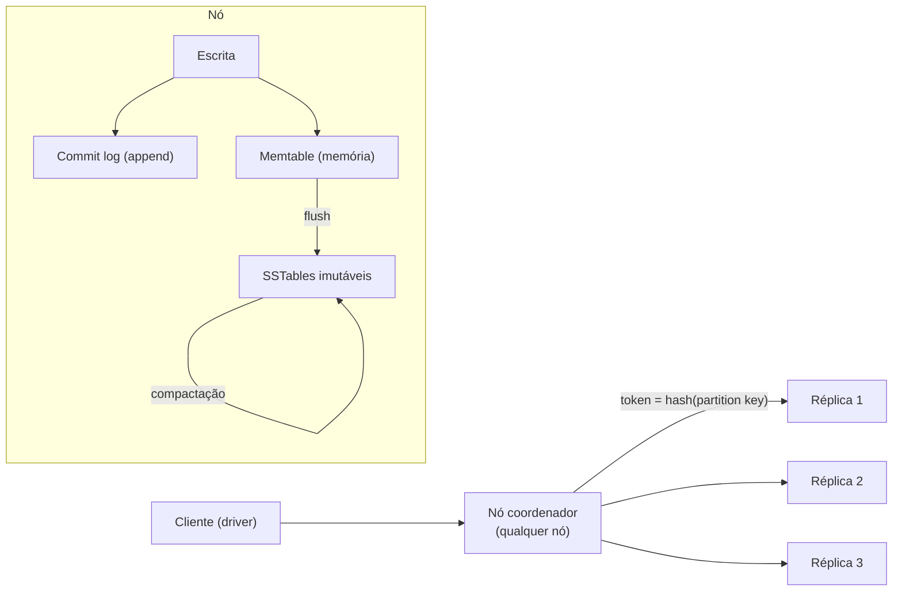

# Pesquisa: paradigma wide-column e Apache Cassandra

Paradigma sorteado para a equipe: **1 – orientado a colunas (wide-column)**, conforme `Equipe - Página1.pdf`. SGBD escolhido: **Apache Cassandra 5.0** (imagem oficial `cassandra:5.0.9`). Comparação com **PostgreSQL 17**.

## 1. O paradigma wide-column

Um banco wide-column organiza os dados em **tabelas cujas linhas são agrupadas em partições**. A chave de partição decide em que nó a linha fica. Dentro da partição, as linhas ficam **ordenadas fisicamente** pelas colunas de *clustering*. Uma partição pode ter de uma a milhões de linhas, daí o nome "linha larga". As colunas são esparsas: uma linha só ocupa espaço pelas colunas que tem.

A família descende de dois trabalhos:

- **Google Bigtable** (artigo de 2006): modelo de dados com mapa ordenado de linhas e colunas e armazenamento em LSM-tree (log, memória, arquivos imutáveis).
- **Amazon Dynamo** (artigo de 2007): distribuição sem mestre por *hashing* consistente, replicação configurável e consistência ajustável.

Representantes: Apache Cassandra e ScyllaDB (Bigtable + Dynamo), Apache HBase (Bigtable sobre HDFS, com mestre) e o próprio Google Bigtable.

**Aplicações adequadas.** Cargas com muita escrita e padrões de acesso conhecidos, por exemplo:

- séries temporais e telemetria de IoT;
- **logs e eventos de segurança** (o cenário deste projeto);
- mensagens e caixas de entrada;
- feeds de atividade e histórico de usuário;
- catálogos e perfis com alta disponibilidade global;
- contadores e métricas em tempo real.

**Aplicações inadequadas.** Consultas *ad hoc* imprevisíveis, *joins* e relatórios analíticos sobre toda a base, transações ACID entre várias entidades (financeiro, estoque com integridade referencial) e bases pequenas, em que a complexidade operacional não se paga.

## 2. Visão geral do Apache Cassandra

| Item | Descrição |
| --- | --- |
| Origem | Criado no Facebook (2008) para a busca na caixa de entrada; aberto em 2008; projeto de topo da Apache Software Foundation desde 2010 |
| Licença | **Apache License 2.0** (software livre, uso comercial permitido) |
| Download | `cassandra.apache.org` (binários e fontes) e imagem oficial `cassandra` no Docker Hub (usada aqui) |
| Linguagem | Java (roda na JVM); consultas em **CQL** (Cassandra Query Language), de sintaxe parecida com SQL |
| Ofertas comerciais e gerenciadas | DataStax (Enterprise e Astra DB); serviços compatíveis com CQL em nuvens públicas (Amazon Keyspaces, Azure Managed Instance for Apache Cassandra); suporte de terceiros. ScyllaDB é uma reimplementação compatível com CQL |
| Versão 5.0 (2024) | *Storage-Attached Indexes* (SAI), tipo vetor e busca vetorial, *Unified Compaction Strategy*, memtables e SSTables baseadas em *trie*, suporte a JDK 17, mascaramento dinâmico de dados |

## 3. Arquitetura

- **Anel sem mestre (peer-to-peer).** Todos os nós têm o mesmo papel. O particionador (Murmur3) transforma a chave de partição em um *token*, e cada nó responde por faixas de tokens (*vnodes*). O protocolo *gossip* espalha a informação de estado e de topologia.
- **Replicação.** O fator de replicação (RF) é definido por keyspace e por datacenter (`NetworkTopologyStrategy`). Qualquer nó pode coordenar uma requisição.
- **Consistência ajustável por operação:** `ONE`, `QUORUM`, `LOCAL_QUORUM`, `ALL` e outros. Com `R + W > RF`, leituras veem a última escrita confirmada. *Lightweight transactions* (LWT, Paxos; `IF NOT EXISTS`, `IF col = x`) dão linearizabilidade em uma partição, a custo de mais rodadas de rede.
- **Caminho de escrita (LSM):** acréscimo ao *commit log*, inserção na *memtable* e confirmação. Depois, a memtable é gravada como SSTable imutável, e a compactação (STCS, LCS, TWCS ou UCS) junta SSTables e descarta versões antigas e *tombstones*. Uma escrita não lê o dado anterior.
- **Caminho de leitura:** memtable + SSTables candidatas (filtradas por *bloom filter* e índices), com fusão por *timestamp*. *Key cache* e *page cache* ajudam.
- **Reparo e anti-entropia:** *hinted handoff*, *read repair* e `nodetool repair` (árvores de Merkle).

## 4. Organização dos dados e mecanismos de consulta

- **Keyspace → tabelas.** A chave primária é `((chave de partição), colunas de clustering)`. A consulta precisa informar a chave de partição completa e pode restringir intervalos nas colunas de clustering, na ordem declarada.
- **Não há *joins* nem chaves estrangeiras.** Modela-se **uma tabela por consulta** (desnormalização), e a aplicação mantém as cópias.
- **`ALLOW FILTERING`** permite varreduras, mas é desaconselhado. Índices secundários (SAI no 5.0) existem, com limites de uso em produção.
- **Recursos de CQL:** *batches* (logged = atômico na aplicação das mutações, mas **não** isolado como uma transação SQL), contadores, TTL, coleções e tipos definidos pelo usuário.

## 5. Escalabilidade

- **Horizontal e linear:** para ganhar capacidade, adicionam-se nós, e o anel redistribui as faixas de tokens.
- **Sem ponto único de falha.** Com RF ≥ 3, o cluster tolera a perda de nós e atende *quorum*.
- **Multi-datacenter nativo,** com `LOCAL_QUORUM` para latência local.
- **Restrições:** partições muito grandes ou "quentes" concentram carga em poucos nós, por isso se recomenda limitar o tamanho da partição (com *buckets* de tempo, por exemplo). A desnormalização aumenta o volume escrito.

**Neste projeto há um único nó.** Ele serve para avaliar modelagem e consultas, mas **não demonstra** escalabilidade nem tolerância a falhas, e isso é dito explicitamente na apresentação.

## 6. Aplicações reais no mercado

Os relatos abaixo vêm de publicações de engenharia das empresas. O porte das instalações muda ao longo do tempo e não foi verificado de forma independente.

- **Apple:** apresentou em eventos da comunidade uma das maiores instalações conhecidas de Cassandra.
- **Netflix:** usa Cassandra extensivamente em serviços de alta disponibilidade e multirregião.
- **Instagram/Meta:** relatou o uso de Cassandra em serviços de grande volume e publicou trabalho de otimização do motor de armazenamento (Rocksandra).
- **Uber:** usa Cassandra em serviços com grande volume de escrita.
- **Discord:** armazenou mensagens em Cassandra por anos e migrou depois para ScyllaDB, outro banco wide-column compatível com CQL. O caso ilustra os custos operacionais (compactação, GC da JVM) discutidos nas limitações.

## 7. Vantagens e desvantagens (resumo)

O detalhamento, com a evidência deste projeto, está em [17-11-vantagens-problema-modelagem.md](17-11-vantagens-problema-modelagem.md).

| Vantagens | Desvantagens |
| --- | --- |
| Escrita rápida e previsível (LSM, sem ler antes de escrever) | Sem *joins*, sem FKs, sem consultas *ad hoc* eficientes |
| Escala horizontal linear e sem mestre | Modelagem orientada a consultas: cada nova pergunta pode exigir nova tabela e migração de dados |
| Alta disponibilidade e multi-datacenter | Transações apenas por partição (LWT), caras; batches não isolam leituras |
| Consistência ajustável por operação | Consistência eventual por padrão; *tombstones*, reparos e compactação exigem operação |
| Partições ordenadas são ideais para séries temporais | Agregações sobre toda a base exigem pré-agregação ou ferramentas externas (Spark) |
