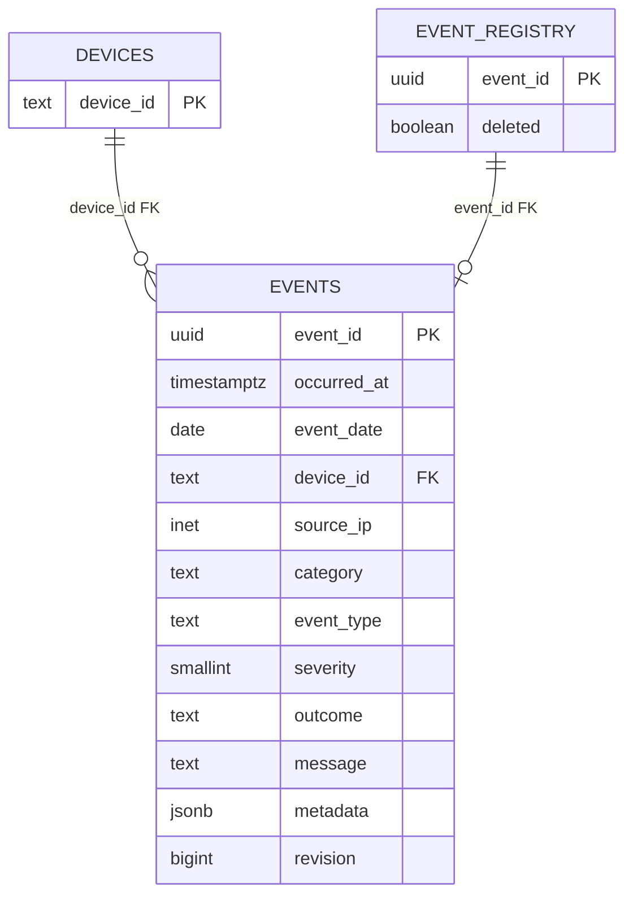
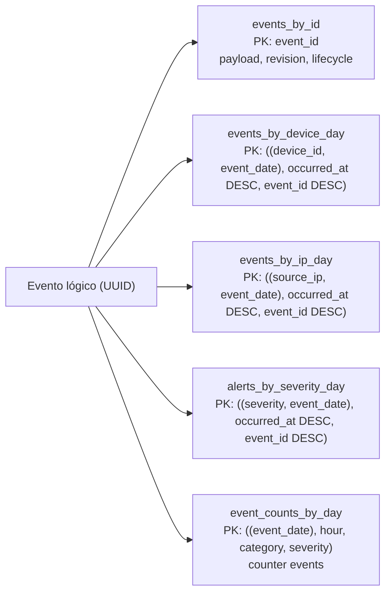

# 17/11: vantagens e desvantagens, definição do problema e modelagem

## 1. Definição do problema

O **CyberGuard** é uma plataforma de monitoramento e investigação de eventos de cibersegurança para um SOC (*Security Operations Center*). Sensores (firewall, VPN, controlador de domínio, IDS, EDR, servidores e estações) emitem continuamente eventos de **autenticação**, **rede** e **alertas**. O SOC precisa:

1. **Ingerir** muitos eventos imutáveis, com identidade única (UUID v4) e horário UTC em milissegundos.
2. **Investigar:**
   - **Q1**, o histórico de um dispositivo;
   - **Q2**, a atividade de um IP de origem;
   - **Q3**, os alertas de uma severidade.

   Todas em uma janela de até 7 dias, do mais recente para o mais antigo, paginadas.
3. **Monitorar** um painel com total de eventos, alertas, distribuição por severidade e categoria, e série horária do período.
4. **Corrigir** um evento (resultado, mensagem, metadados) com controle de revisão e **excluí-lo** sem permitir que o UUID seja reutilizado.

Um **registro lógico** é um evento identificado por UUID, independentemente de quantas linhas físicas o representem. O contrato, inspirado no OCSF 1.3.0 sem implementá-lo integralmente, está em [../data-model.md](../data-model.md).

**Por que o cenário serve ao paradigma:** eventos de segurança formam uma série temporal de alta taxa de escrita, imutável na identidade e consultada por chaves conhecidas (dispositivo, IP, severidade) e por janelas de tempo. É o caso de uso clássico do wide-column: partições por chave e dia, ordenadas por tempo, e agregados pré-calculados para painéis. O cenário também tem pontos em que o relacional é mais natural, como correção com revisão, unicidade global do UUID e consultas *ad hoc*, o que torna a comparação honesta.

## 2. Modelagem relacional (PostgreSQL)

- **Normalizado:**
  - cada evento existe **uma vez**, com tipos nativos (`timestamptz`, `inet`, `jsonb`);
  - `devices` guarda a identidade do dispositivo;
  - `event_registry` reserva o UUID e mantém um marcador depois do DELETE.
- **Integridade declarativa:** PKs, FKs com `RESTRICT` e CHECKs de UUID v4, data UTC, precisão em milissegundos, IP de host, enums e combinação categoria/tipo.
- **Índices para cada padrão de acesso:**
  - `(device_id, occurred_at DESC, event_id DESC)` para Q1;
  - `(source_ip, …)` para Q2;
  - parcial `(severity, …) WHERE category='alert'` para Q3;
  - de cobertura `(occurred_at) INCLUDE (category, severity)` para o painel.
- **Mutações em transação**, com `SELECT … FOR UPDATE` na reserva do UUID. O painel é **agregado na leitura** (`GROUP BY`), portanto sempre exato.

## 3. Modelagem wide-column (Cassandra)

- **Uma tabela por consulta:** Q1, Q2 e Q3 têm projeções próprias. A partição é chave + dia, para limitar o tamanho; em 1 M de eventos, a maior tem 11 822 linhas, cerca de 0,45 MB. As colunas de clustering são `occurred_at DESC, event_id DESC`, a mesma ordem e o mesmo desempate do SQL.
- **Registro canônico por ID:** as projeções guardam só chaves imutáveis. Conteúdo, revisão e ciclo de vida ficam em `events_by_id`. Assim um UPDATE escreve uma única linha e não há cópias divergentes.
- **Rollup do painel:** `event_counts_by_day` guarda o painel já pronto. Cada dia é uma partição com contadores por hora × categoria × severidade, atualizados no momento da escrita.
- **Sem FKs nem transações entre tabelas.** O ciclo de vida `pending → active → deleting → deleted` usa LWT (Paxos) e *logged batch*, e pode ser recuperado por ID. Detalhes em [../consistency.md](../consistency.md).

### Por que os modelos diferem

| Decisão | PostgreSQL | Cassandra | Motivo |
| --- | --- | --- | --- |
| Onde fica o conteúdo | 1 linha tipada | 1 linha canônica (JSON validado) | O Cassandra não tem *join*, e o conteúdo mutável não deve ser copiado |
| Acesso por dispositivo/IP/severidade | Índices secundários na mesma tabela | Três tabelas-projeção | A consulta precisa informar a partição; não há índice global eficiente |
| Unicidade do UUID e "não reutilizar" | PK + `event_registry` em transação | LWT `IF NOT EXISTS` + estado `deleted` | O Cassandra não tem restrição de unicidade |
| Painel agregado | `GROUP BY` na leitura + índice de cobertura | Contadores pré-agregados na escrita | Agregar varrendo partições seria caro; no paradigma, a resposta é desnormalizada |
| Integridade | FKs e CHECKs no banco | Validação na API (Rust) + reconciliação | O Cassandra não tem FKs nem CHECKs |

## 4. Comparação técnica (relacional × wide-column)

| Aspecto | PostgreSQL | Cassandra |
| --- | --- | --- |
| Modelo de dados | Tabelas normalizadas, esquema rígido e tipado | Tabelas particionadas e linhas ordenadas por clustering, desenhadas por consulta |
| Relações/associações | FKs, *joins*, integridade referencial | Sem *joins* nem FKs; relações materializadas pela aplicação |
| Linguagem | SQL completo (agregações, subconsultas, *window functions*) | CQL: partição obrigatória, intervalos no clustering, sem *join*, agregação limitada |
| Consistência/transações | ACID, MVCC, transações multitabela, isolamento configurável | Consistência ajustável por operação; LWT só por partição; batch sem isolamento |
| Índices | B-tree, parciais, de cobertura, GIN e outros; o planner escolhe | A chave primária é o índice; SAI/secundários limitados; desnormalização |
| Escalabilidade | Vertical; leitura por réplicas; *sharding* exige extensões ou aplicação | Horizontal linear, sem mestre, multi-datacenter nativo |
| Escrita | WAL + B-trees atualizadas no lugar; `fsync` por commit por padrão | LSM: commit log + memtable, sem ler antes de escrever; `fsync` periódico por padrão |
| Cenários | Transacional, relatórios *ad hoc*, integridade forte | Séries temporais, eventos, alto volume de escrita, alta disponibilidade global |

## 5. Vantagens e desvantagens do Cassandra, com evidência deste projeto

| | Observação no CyberGuard |
| --- | --- |
| **Vantagem:** consultas modeladas são previsíveis | O painel de 7 dias lê 7 partições pequenas: 3,3 ms (HTTP) contra 71,9 ms do PostgreSQL agregando 245 mil entradas (21,9×). É o ganho da pré-agregação: com view materializada, o PostgreSQL lê na mesma ordem de grandeza, mas depende de REFRESH |
| **Vantagem:** escrita barata e desnormalização viável | O contador do rollup é incrementado a cada evento sem *lock* de linha; o CREATE já mantém 3–4 linhas por evento |
| **Vantagem:** escala horizontal e disponibilidade | Teórica neste projeto: um nó não demonstra |
| **Desvantagem:** leituras por resultado na modelagem escolhida | Q1–Q3 de 1,9× a 4,0× mais lentas que o índice B-tree. Antes da otimização do N+1, eram de 12× a 17× mais lentas |
| **Desvantagem:** sem transação e sem unicidade nativa | O CREATE precisa de 2 LWT + batch; quando os dois bancos confirmam antes do fsync, o PostgreSQL escreve de 1,1× a 2,2× mais rápido |
| **Desvantagem:** contadores não idempotentes | O rollup pode desviar após falha parcial; existe a ferramenta `reconcile_rollup.py` (desvio provocado, detectado e corrigido) |
| **Desvantagem:** cada nova pergunta pode exigir nova tabela | O painel exigiu uma tabela nova e o backfill de 1 M de eventos; no PostgreSQL, bastou um índice |
